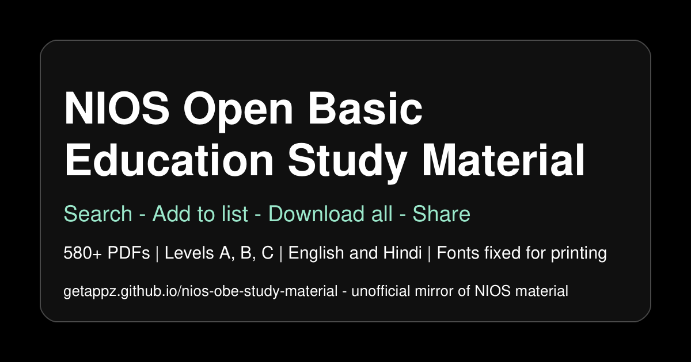

# 📚 NIOS Open Basic Education — study material, print-ready

<p align="center"><a href="https://getappz.github.io/nios-obe-study-material/"></a></p>

## 👉 [Open the search & download site](https://getappz.github.io/nios-obe-study-material/)

Search by subject, level or medium → add files to your list (like a cart) → **download them all at once** or **share the list on WhatsApp**.

- **617 PDFs** from [NIOS Open Basic Education](https://nios.ac.in/departmentsunits/academic/open-basic-education-(obe)/obesimen.aspx): Levels A, B, C (Class 1–8), English & Hindi medium, Indian Knowledge Tradition (Veda, Vijnana, Yoga, Sanskrit, Vocational Skills) and sample question papers.
- **Fonts fixed for printing.** Many NIOS PDFs show Hindi/Sanskrit headings and verses as junk (`ifjp; izLrqfr`) on computers without the Kruti Dev font. Here the font is embedded, so they print correctly (`परिचय प्रस्तुति`). Images were also reduced to 220 dpi so files are lighter.
- **Organised exactly like the NIOS page**: Medium → Level → Subject.

> 🕒 **Last checked against NIOS: 2026-11-27 10:01 UTC** · **Newest file change: 2026-11-27 10:00 UTC**
> Always compare with the [official NIOS site](https://nios.ac.in) for the latest edition.

## Browse the files

Prefer a plain list? Everything is in **[INDEX.md](INDEX.md)** — every file with size, download link and the NIOS original:
[English Medium](INDEX.md#english-medium) · [Hindi Medium](INDEX.md#hindi-medium) ·
[Indian Knowledge Tradition](INDEX.md#indian-knowledge-tradition-भारतीय-ज्ञान-परम्परा) ·
[Sample question papers](INDEX.md#sample-question-papers--question-paper-design).
Files of 10 MB or more are attached to the [`large-files-v1` release](../../releases/tag/large-files-v1) (marked ⬇) so the repo stays light to clone.

Level guide (NIOS equivalence): **A** = Class 1–3 · **B** = Class 4–5 · **C** = Class 6–8.

## What was changed from the NIOS originals

| Change | Where | Detail |
|---|---|---|
| **Kruti Dev font embedded** | Files whose headings / Sanskrit verses referenced the Kruti Dev font without embedding it | The real Kruti Dev font (published by NIOS itself) was embedded, so the text renders exactly as intended. No text was retyped or converted. |
| **Smaller for printing** | Image-heavy PDFs | Images above 300 dpi were reduced to 220 dpi (JPEG q80). Text and layout unchanged. |

Content is otherwise unchanged. Scanned books (Science / Social Science, English medium) have no text layer. Five NIOS links were dead when this was collected (404 or a web page instead of a PDF), so they are not mirrored: Vijnana B English chapter 11, Veda C Sanskrit chapter 6, and the Vocational Skills question papers for Levels A, B and C. Found an error? Please [open an issue](../../issues).

## Printing tips

- Print at **actual size / 100 %**, not "fit to page".
- Send the PDF as-is to a print shop — fonts are embedded.

## Help spread the word

If this saved you time, please ⭐ star the repo and share the [site](https://getappz.github.io/nios-obe-study-material/) with other NIOS learners, tutors and study-centre coordinators. Sharing a list from the site gives people exactly the files you picked.

## Maintainers: updating

NIOS blocks GitHub-hosted runners, so updates run on a machine that can reach nios.ac.in:

```
mise run sync:check     # what changed on NIOS since the last sync
mise run sync           # re-process changed PDFs, upload 10 MB+ files to the release, update README + INDEX, commit, push
mise run sync:force     # re-process everything
```

Without mise: `python tools/sync.py --dry-run` / `--publish` (after `pip install pymupdf curl_cffi`). State lives in `data/manifest.json`; the site reads it directly.
Other tools: `tools/fix_krutidev.py in.pdf out.pdf <font-dir>` (embed Kruti Dev), `tools/optimize.py in.pdf out.pdf` (shrink images). Scripts are MIT-licensed; **the PDFs are not**.

## Copyright and reuse

NIOS's [Terms & Conditions](https://nios.ac.in/terms-conditions.aspx) state:

> Material featured on this site may be reproduced free of charge in any format or media without requiring specific
> permission. This is subject to the material being reproduced accurately and not being used in a derogatory manner
> or in a misleading context. Where the material is being published or issued to others, the source must be
> prominently acknowledged. However, the permission to reproduce this material does not extend to any material on this
> site, which is explicitly identified as being the copyright of a third party.

This repository follows those terms: the source is acknowledged above, content is reproduced accurately (changes are
listed), and the PDFs are **not** relicensed. Third-party material inside the books remains with its owners. This is an
unofficial mirror, not affiliated with or endorsed by NIOS. If NIOS or a rights holder asks for removal, the affected
files will be removed.
